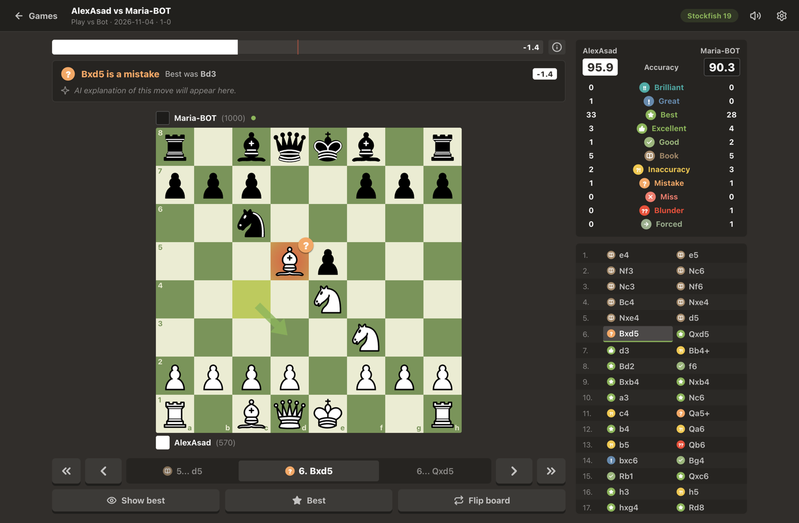

<p align="center">
  
</p>

<h1 align="center">Chess Coach</h1>

<p align="center">
  Free desktop game review powered by <b>Stockfish 19</b>: move-by-move analysis, chess.com-style move grades, and the engine's best lines.<br>
  Runs fully offline. No account, no subscription.
</p>

<p align="center">
  <a href="../../releases/latest/download/Chess-Coach-macOS.dmg"><b>⬇ Download for macOS (.dmg)</b></a>
  &nbsp;·&nbsp; Intel &amp; Apple Silicon, macOS 11+
  &nbsp;·&nbsp; <a href="../../releases/latest">All releases</a>
</p>

<p align="center">
  
</p>

## Install (macOS)

1. Download **[Chess-Coach-macOS.dmg](../../releases/latest/download/Chess-Coach-macOS.dmg)**.
2. Open it and drag **Chess Coach** into **Applications**.
3. Start it. The first time, macOS will ask you to confirm (see below).

Everything is included, the Stockfish engine too. There is nothing else to install.

### Security prompts: what to allow and why

| When | What to do | Why |
|---|---|---|
| **First launch:** *"Apple could not verify Chess Coach…"* | Click **Done**. Then open **System Settings → Privacy & Security**, scroll down, and click **Open Anyway** next to "Chess Coach". Confirm with your password. This is needed only once. | The app is free and isn't registered with Apple's paid developer program, so it isn't *notarized*. macOS blocks every non-notarized app until you approve it. The app is still signed, and macOS checks it hasn't been modified. |
| **Adding an AI API key:** *"Chess Coach wants to use … 'Chess Coach Safe Storage' in your keychain"* | Enter your Mac password and click **Always Allow**. | Your API keys are stored encrypted with the macOS Keychain, never in plain text. After an app update macOS may ask once more. |

The command-line alternative to *Open Anyway* is:

```bash
xattr -dr com.apple.quarantine "/Applications/Chess Coach.app"
```

Nothing else needs permission. Chess Coach doesn't use the network, the camera, the microphone or your contacts. It only reads the PGN files you choose or drag in.

## Features

- **Import any game:** choose a `.pgn` (or any text file with moves), paste PGN, or drag files onto the window.
  - Files with many games are split automatically; chess.com and lichess exports work as they are.
- **Game library:** games are stored inside the app, so they don't depend on the original file.
  - Sort by name, moves, date or recently opened, and search.
  - Analysed games show both players' accuracy.
- **Engine review:** Stockfish 19 analyses every position.
  - A quick pass fills in the review within seconds, then a deep pass (depth 20, adjustable) refines it.
  - Results are saved, so a game is analysed only once.
- **Move grades like chess.com:** Brilliant, Great, Best, Excellent, Good, Book, Inaccuracy, Mistake, Miss, Blunder, Forced. Each grade has its badge on the board and in the move list, plus an accuracy score per player.
- **Best move arrow:** after an inaccuracy, mistake or blunder, a green arrow shows what should have been played. **Show best** draws the best move for the side to move.
- **Best lines:** **Best** opens 26-move engine lines (adjustable) for the move.
  - **"Best: …"** shows what should have happened.
  - **"After …"** shows how the mistake gets punished.
  - At the end of a line, **"+ Calculate more"** continues it.
- **Eval bar and graph:** a horizontal eval bar, and an evaluation graph (ⓘ) you can click to jump to any move.
- **Board:** 4 board themes and 4 piece sets (Classic, Neo, Chessnut, Merida).
  - Fast piece animation, coordinates, flip, « ‹ › » navigation and keyboard shortcuts.
  - Captures and checks briefly flash red under the piece.
- **Sound:** a soft wooden move sound, with volume control.
- **Settings:** board, pieces, sound, engine depth, line length, and AI API keys for the upcoming AI move explanations. Keys are encrypted and can be named, copied, deleted, and one chosen as active.

**Keyboard:**

| Key | Action |
|---|---|
| `←` / `→` | Previous / next move |
| `↑` / `Home` | Start |
| `↓` / `End` | End |
| `F` | Flip board |
| `Esc` | Close the line, or go back to the library |

## How the analysis works

1. **Engine.** Stockfish 19 runs locally as a separate program. Every position is analysed with its 2 best moves, first at depth 12, then at depth 20.
2. **Winning chances.** Each evaluation becomes the mover's expected score from 0 to 1, using lichess's winning-chances curve.
3. **Grades.** A move is graded by how much expected score it gives up compared with the engine's best move. These are chess.com's published thresholds:

   | Loss | Grade |
   |---|---|
   | ≈ 0 | Best |
   | ≤ 0.02 | Excellent |
   | ≤ 0.05 | Good |
   | ≤ 0.10 | Inaccuracy |
   | ≤ 0.20 | Mistake |
   | > 0.20 | Blunder |

4. **Special grades:**
   - **Book:** the position is in the lichess opening database.
   - **Forced:** the only legal move.
   - **Great:** the only good move.
   - **Miss:** failing to punish the opponent's mistake.
   - **Brilliant:** a best or near-best move that gives up at least a minor piece which the move itself left capturable. It is calibrated to be rare: about 1 in 10 games at club level.
5. **Accuracy.** lichess's accuracy formula, per move and per player.

Implementation details are in [`src/main/analysis-service.js`](src/main/analysis-service.js) and [`src/renderer/js/analysis/classify.js`](src/renderer/js/analysis/classify.js). The engine choice is explained in [`docs/engine-research.md`](docs/engine-research.md).

## Build from source

Requirements: Node.js 20+ and, on macOS, the Xcode Command Line Tools.

```bash
npm install
```

```bash
npm start
```

```bash
npm test
```

```bash
npm run dist:mac
```

`npm install` also downloads Stockfish 19 and the Electron runtime. `npm run dist:mac` builds `dist/Chess-Coach-macOS.dmg`; `dist:win` and `dist:linux` exist too. The full guide, including notarization with an Apple Developer ID, is in **[DEVELOPMENT.md](DEVELOPMENT.md)**.

To publish a release, attach `dist/Chess-Coach-macOS.dmg` to a GitHub Release. The download link at the top of this page always points to the latest release.

## Credits and licences

| Component | Author | Licence |
|---|---|---|
| Chess engine: [Stockfish 19](https://github.com/official-stockfish/Stockfish) | The Stockfish developers | GPL-3.0. Shipped as a separate program with its licence and source link. |
| Move generation and PGN: [chess.js](https://github.com/jhlywa/chess.js) | Jeff Hlywa | BSD-2-Clause |
| Classic pieces (Cburnett) | Colin M.L. Burnett, via [cm-chessboard](https://github.com/shaack/cm-chessboard) | CC BY-SA 3.0 / GPL-2.0+ |
| Neo ("Kosal") pieces | Kosal Sen, from [lichess](https://github.com/lichess-org/lila) | AGPL-3.0+ |
| Chessnut pieces | [Alexis Luengas](https://github.com/LexLuengas/chessnut-pieces) | Apache-2.0 |
| Merida pieces | Armando Hernandez Marroquin | GPL-2.0+ |
| Opening names | [lichess-org/chess-openings](https://github.com/lichess-org/chess-openings) | CC0 |
| Sounds ("Impact Sounds") | [Kenney](https://kenney.nl/assets/impact-sounds) | CC0 |
| UI and badge glyphs | [Lucide](https://lucide.dev) | ISC |
| App icon knight | Adapted from Cburnett's knight | CC BY-SA 3.0 |

Licence files for bundled assets are next to them: `src/renderer/assets/*/LICENSE.txt`, and `engine/*/Copying.txt` for Stockfish.

Move-grade thresholds follow chess.com's public description of Game Review. The accuracy formula is lichess's. Chess Coach is not affiliated with chess.com or lichess.

## Troubleshooting

- **"Engine unavailable" in the review header** (when running from source): run `npm run fetch-engine`.
- **`npm start` says Electron is missing:** run `node scripts/ensure-electron.js`.
